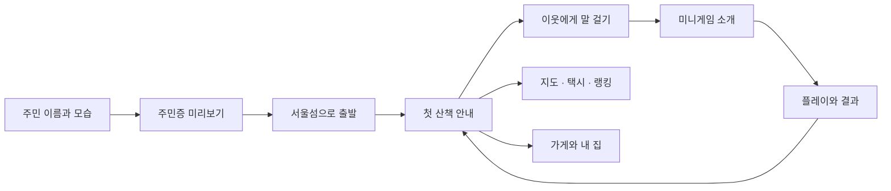

# 두근두근 서울섬 — UI 기획안

기준일: 2026-10-19 · 선택 범위: 주민 생성 + 게임 HUD + 공통 창

## 디렉션: 서울섬 이사 수첩

서울의 명소를 걸어 다니고, 동물 이웃을 만나고, 작은 놀이를 즐기는 게임이다. 첫 화면의 목적은 캐릭터 설정을 끝내고 섬에서 첫걸음을 내딛게 하는 것이다. UI는 이사 신청서, 주민증, 산책 지도, 가게 가격표처럼 게임 세계 안에 있을 법한 물건으로 표현한다.

첨부 이미지의 크림색 바탕, 분홍 제목, 둥근 선택지와 부드러운 그림자를 계승한다. 주민 생성에는 종이 도장과 점선 구분선을 사용한다. 게임 중에는 작은 정보와 도구만 화면 가장자리에 둔다. 공격적인 알림, 과도한 반짝임, 반복 보상 압박은 추가하지 않는다.


위 이미지는 **이미지 생성 도구로 만든 아트 디렉션 콘셉트**다. 캐릭터·상점 상품·가방·미니게임 메뉴와 풍경의 세부 표현은 구현 화면과 다르며, 새 게임 기능이나 3D 에셋의 완성을 뜻하지 않는다. 실제 구현은 아래 스크린샷과 소스가 기준이다. 생성 프롬프트는 [image-prompt.txt](image-prompt.txt)에 보관한다.

## 플레이 흐름



## 화면별 설계

| 화면 | 정보와 행동의 우선순위 | 구현 상태 |
|---|---|---|
| 주민 생성 | 환영 인사 → 주민증 → 이름 → 주민 종류 → 색상 → 출발 | 새 레이아웃과 전용 3D 무대 적용 |
| 산책 HUD | 왼쪽 위 위치·벨·주민, 오른쪽 위 지도, 왼쪽 아래 시계, 하단 탐색 메뉴 | 새 레이아웃 적용 |
| 첫 산책 안내 | WASD/땅 클릭 → 노란 별 이웃에게 E | 간결한 안내 카드 적용, 첫 이동 때 숨김 |
| NPC 대화 | 이름 탭 → 대화 → 선택지 | 기존 기능에 공통 종이 테마 적용 |
| 택시 | 검색 → 목적지·소요·요금 → 이동, 이동 불가 이유 | 공통 창·포커스 처리 적용 |
| 지하철 | 현재 역 → 노선도 → 목적지·시간 | 공통 창·포커스 처리 적용 |
| 상점/옷장/미용실/가구 | 가게·보유 벨 → 분류 → 물건 → 미리보기 → 행동 | 공통 창·선택 체크·카드 스타일 적용 |
| 랭킹 | 게임 선택 → 순위 또는 서버 연결 안내 → 닫기 | 공통 창·포커스 처리 적용 |
| 미니게임 | 소개 → 목표·시간·점수 → 결과 | 기존 정보 구조 유지, 공통 토큰 적용 |
| 결과 | 점수 → 최고 기록 → 받은 벨 → 다시 하기/돌아가기 | 종이 구분선·보상 영역·버튼 스타일 적용 |
| 채팅/주민 목록 | 대화 중인 주민·새 메시지·보내기 | 기존 기능 유지, HUD 위치와 토큰 반영 |

### 주민 생성

- 데스크톱: 최대 540px 신청서를 왼쪽에 배치하고, 오른쪽에 실제 3D 주민을 표시한다. 전용 무대로 월드의 나무·건물에 가리지 않게 한다.
- 작은 화면: 신청서를 중앙에 두고 화면 높이를 넘으면 신청서 내부에서 스크롤한다. 색상은 줄바꿈된다. 축소 화면의 기준 미리보기는 주민증이다.
- 이름은 최대 8자. 비어 있거나 공백뿐이면 이유를 알려 주고 출발하지 않는다. 한글 조합 중 Enter는 출발로 처리하지 않는다.
- 이름을 입력하면 주민증에 즉시 반영한다. 사람을 고르면 피부·머리, 동물을 고르면 털색이 나온다.
- 선택 버튼은 `aria-pressed`와 체크 표시를 함께 사용한다. 색상 버튼은 색상 이름 또는 번호·색상 코드로 구분할 수 있다.
- 저장 중에는 선택지와 출발 버튼을 잠근다. 실패하면 같은 화면에서 다시 출발할 수 있다.
- 같은 이름으로 재접속하면 기존 주민을 이어서 사용한다는 현재 데모 정책을 입력 아래에 설명한다.


### 산책 HUD

- 위치/재화/연결 상태는 좌측 상단, 동그란 지도는 우측 상단에 둔다.
- 하단 메뉴에는 **지도 / 택시 / 랭킹 / 조작법**을 둔다. 실제 연결된 기능만 제공한다.
- 조작법은 필요할 때 여는 작은 카드로 제공한다. 지도와 조작법은 선택 상태가 보인다.
- 시계는 날짜와 시간을 나누고 숫자 폭을 고정한다. 모바일에서는 시계를 하단 메뉴 위로 올린다.
- 상호작용 E는 하단 메뉴 위에 표시한다. 실내, 열차, 가구 배치, 대화 등 기존 엔진 상태에 따른 표시 조건을 유지한다.
- 실제 터치 기기의 방향 패드와 키보드 조작을 유지한다. 브라우저의 작은 화면 크기와 실제 터치 기기는 별도로 검증해야 한다.


### 공통 창

`PanelFrame`을 택시·지하철·랭킹·상점에 적용한다. 배경은 약하게 흐려지고, 창을 누르는 동안 월드 클릭을 가린다. Esc 또는 배경 클릭으로 닫을 수 있다. Tab/Shift+Tab은 창 안에 머물며, 닫으면 창을 열었던 버튼으로 초점이 돌아간다. 이름표가 있는 NPC 말풍선은 월드 상호작용 구조를 유지한다.

창은 제목 → 설명/검색/분류 → 내용 → 행동 순서를 따른다. 성공 행동은 짙은 풀빛, 보조 행동은 크림색이다. 선택한 상점 물건은 테두리와 체크를 사용한다. 벨 부족, 가까운 목적지, 빈 검색 결과, 서버 연결 불가 등 기존 상태별 문구를 유지한다.

## 디자인 토큰

2026-10-19 콘셉트 반영 업데이트: `game-ui-design`의 patterns/validations를 기준으로 수채화 스티커, 스티치 종이 패널, 엽서, 숲빛 버튼을 실제 UI에 적용했다. 주민 선택에는 8종 그림을 넣고, 옷 색은 필요할 때 펼치는 방식으로 정리했다. 출발 버튼은 스크롤 영역 밖에 두어 계속 보이게 했다. 주민 종류·색상은 방향키로도 이동·선택할 수 있다. 게임패드 지원을 새로 구현한 것은 아니다.

종이 바탕은 `#FFF8E7`, 본문은 `#624C35`, 보조 글씨는 `#7C684E`, 주요 버튼은 `#45694A`로 조정했다. 이번에 수정한 신청서·탐색 메뉴·주요 안내 문구는 최소 14px를 사용하고, 주 행동과 작은 지도 확대 버튼은 44–48px 이상의 누를 수 있는 영역을 둔다. 아래 표는 첫 기획의 기준값이며 최종 스타일은 `scrapbook-ui.css`가 우선한다.

새 아트는 내장 image_gen으로 생성한 `frontend/public/art/ui-stickers.png`와 `seoul-welcome-landscape.png`다. 배경은 주민 생성용 그림이며 실제 게임 지형을 대체하지 않는다. 실제 3D 모델은 기존 모형을 유지한다. [에셋 생성 프롬프트](scrapbook-asset-prompts.txt)를 함께 보관한다.

| 역할 | 값 | 사용 |
|---|---|---|
| 종이 | `#FFFBED` | 신청서·창·말풍선 |
| 본문 | `#544B3A` | 읽을 수 있는 따뜻한 갈색 |
| 보조 글씨 | `#786C53` | 설명·날짜 |
| 주 행동 | `#42694F` | 출발·구매·선택 |
| 행동 눌림 | `#34543E` | 버튼 깊이와 hover |
| 브랜드 분홍 | `#D88393` | 작은 게임명·도장 분위기 |
| 선택지 바탕 | `#F4EEDB` | 보조 버튼·분류 |
| 구분선 | `#DFD7BF` | 점선·종이 경계 |

- 제목·버튼: 기존 **Jua**, 안내 문장: **Gowun Dodum**. 노을에도 글꼴은 유지하고 색상만 보랏빛으로 바꿔 정보 구조를 일관되게 한다.
- 큰 제목 26–35px, 창 제목 23–26px, 버튼 14–21px, 보조 설명 11–13px. 보조 설명은 확대 기능과 함께 확인한다.
- 간격은 4/8/12/16/24/32px를 기본으로, 미세 정렬에 필요한 값만 보완한다.
- 창 모서리 28px, 카드 18px, 입력 13px, 주요 버튼 17px. 종이 그림자는 짧고 부드럽게 한다.
- 주요 터치 버튼 44px 이상. 가게의 보조 분류는 40px이며 넓은 간격을 둔다.
- `prefers-reduced-motion`에서는 CSS 애니메이션·전환을 줄인다. 3D 월드의 전체 애니메이션 정지는 이번 범위에 포함하지 않는다.

## 구현 구조와 적용 순서

```text
App (기존 Three.js canvas + React 화면)
 ├ MakeScreen → 주민증·선택·검증·출발
 ├ WorldHud → 상태 표시·지도·하단 메뉴
 ├ PanelFrame → 택시/지하철/랭킹/상점 공통 동작
 └ island-ui.css → 공통 토큰·종이 테마·반응형
```

추가 UI 라이브러리를 설치하지 않고 기존 React/Three.js 구성을 사용했다. 외부 저장소에서는 시각 원칙과 상태 설계만 참고했으며 신규 외부 코드·이미지·에셋을 복사하지 않았다. 엔진 변경은 DOM 버튼의 Enter/Space 충돌 방지와 주민 생성 전용 무대에 집중했다. 미니게임, 저장 API, 아이템 가격과 멀티플레이 규약은 기존 것을 사용한다.

게임 전체의 후속 완성은 다음 순서가 적합하다. 이번에 만든 토큰을 기준으로 23개 미니게임의 고유 안내 UI를 개별 검토하고, 종별 주민증 삽화·상점 상품 아이콘을 새로 제작한 다음, 실제 터치 기기와 서버가 연결된 멀티플레이에서 채팅·상점·기록 흐름을 확인한다. 콘셉트 이미지의 풍경 수준을 구현하려면 별도의 3D 아트 작업이 필요하다.

## 검증과 확인할 범위

실제 확인 결과와 제한은 [VALIDATION.md](VALIDATION.md)에 기록한다. 참고 저장소의 비교와 소스 근거는 [리서치 보고서](../../github-research-output/seoul-island-ui/phase6_blueprint/final_report.md)에 있다.

로컬 실행: `frontend`에서 `npm ci`, `npm run dev`. 화면은 `http://127.0.0.1:5173/`에서 확인한다. 별도 저장 칸은 `?slot=ui-review`를 사용한다.
